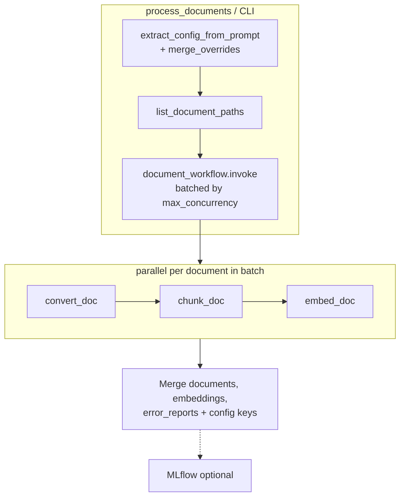
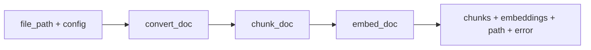
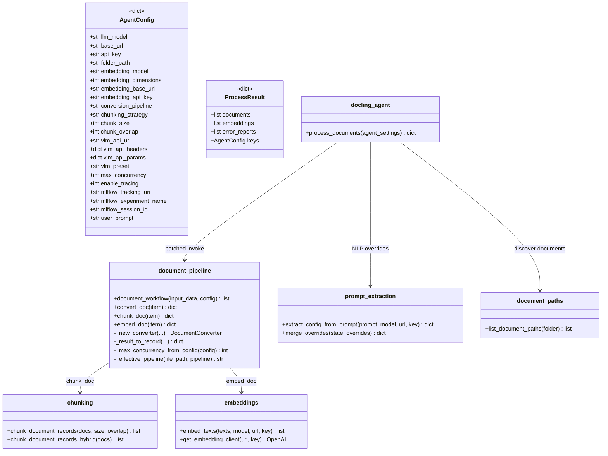

# Docling Document Processing Agent

LangGraph workflow that discovers documents (PDF, DOCX, XLSX, Markdown, HTML, LaTeX), converts them in **parallel batches** with **docling**, chunks text with overlap, and requests **OpenAI-compatible** embeddings per chunk. Optional **MLflow** tracing records runs, spans, and metrics when `ENABLE_TRACING=1`.

## Setup

1. **Python 3.11+** and [uv](https://docs.astral.sh/uv/) (recommended).

2. Install dependencies:

   ```bash
   uv sync
   ```

3. **Environment**: Create a `.env` file in the project root (see `.env` for the full list of configurable variables). All settings can also be overridden via shell environment variables.

4. **MLflow (optional)**: For tracing, set `ENABLE_TRACING=1`, point `MLFLOW_TRACKING_URI` at your server (default `http://localhost:5000`), and set `MLFLOW_EXPERMENT_NAME` (default **Docling Agent**). Pipeline worker modules read `ENABLE_TRACING` from the environment at import time, so load `.env` (or export the variable) before importing graph modules if spans should appear inside `convert_doc` / `chunk_doc` / `embed_doc`.

## Usage

```python
from src.setup import load_environment_variables
from src.docling_agent import process_documents

agent_settings = load_environment_variables(".env")
# or pass a config dict directly:
# agent_settings = {
#     "folder_path": "./pdfs",
#     "user_prompt": "Use VLM pipeline and hybrid chunking with 500 char chunks",  # optional NLP extraction
#     "embedding_model": "text-embedding-ada-002",
#     "embedding_dimensions": 1536,
#     "embedding_base_url": "https://api.openai.com/v1",
#     "embedding_api_key": "your-api-key-here",
#     "conversion_pipeline": "standard",  # or "vlm" (PDF only)
#     "chunking_strategy": "fixed",        # or "hybrid"
#     "chunk_size": 1000,
#     "chunk_overlap": 100,
#     "max_concurrency": 4,
#     "enable_tracing": 0,
#     "mlflow_tracking_uri": "http://localhost:5000",
#     "mlflow_experiment_name": "Docling Agent",
# }

result = process_documents(agent_settings)
# result merges resolved agent_settings with:
#   documents      — list of chunk records (content + metadata)
#   embeddings     — list[list[float] | None], one per chunk
#   error_reports  — list of {"path", "error"} for files that failed
chunks = result["documents"]
vectors = result["embeddings"]
if result.get("error_reports"):
    for err in result["error_reports"]:
        print(f"Failed: {err['path']}: {err['error']}")
```

CLI (uses `FOLDER_PATH` and other variables from the `.env` file or the configured defaults):

```bash
uv run python -m src.docling_agent
# Custom env file:
uv run python -m src.docling_agent --envfile .env.local
# User prompt for NLP extraction:
uv run python -m src.docling_agent --user_prompt "Use VLM pipeline and hybrid chunking"
```

When `enable_tracing` is truthy in loaded settings, the CLI calls `process_documents(..., enable_tracing=True)` for an MLflow run with top-level spans and metrics.

## Environment Variables

| Variable | Default | Role |
|---|---|---|
| `FOLDER_PATH` | `./pdfs` | Directory containing documents to process |
| `EMBEDDING_API_KEY` | `your-api-key-here` | API key for the embedding endpoint |
| `EMBEDDING_BASE_URL` | `https://api.openai.com/v1` | Base URL of the OpenAI-compatible API |
| `EMBEDDING_MODEL` | `text-embedding-ada-002` | Model id passed to the embeddings API |
| `EMBEDDING_DIMENSIONS` | `1536` | Expected vector size for the chosen model |
| `CHUNK_SIZE` | `1000` | Characters per fixed-size chunk |
| `CHUNK_OVERLAP` | `100` | Overlap between consecutive fixed-size chunks |
| `CONVERSION_PIPELINE` | `standard` | `standard` (multi-format docling pipeline) or `vlm` (PDF only) |
| `CHUNKING_STRATEGY` | `fixed` | `fixed` (character-based) or `hybrid` (document-aware) |
| `LLM_MODEL` | `gpt-4o-mini` | LLM model for NLP extraction |
| `BASE_URL` | `https://api.openai.com/v1` | Base URL for the LLM |
| `API_KEY` | `your-api-key-here` | API key for the LLM |
| `VLM_API_URL` | `https://api.openai.com/v1` | Remote VLM endpoint URL (required when `CONVERSION_PIPELINE=vlm`) |
| `VLM_API_HEADERS` | `{}` | JSON object of headers for the VLM API |
| `VLM_API_PARAMS` | `{}` | JSON object of params for the VLM API |
| `VLM_PRESET` | `smoldocling` | Preset name for the VLM conversion |
| `MAX_CONCURRENCY` | CPU count (`os.cpu_count()`) | Max documents per parallel batch in `document_workflow` |
| `ENABLE_TRACING` | `0` | Non-zero enables MLflow spans in pipeline modules and the instrumented CLI path |
| `MLFLOW_TRACKING_URI` | `http://localhost:5000` | Tracking server URL → `mlflow_tracking_uri` |
| `MLFLOW_EXPERMENT_NAME` | `Docling Agent` | Experiment name → `mlflow_experiment_name` (env key spelling matches `agent_settings.py`) |
| `MLFLOW_SESSION_ID` | _(unset)_ | Optional trace session override → `mlflow_session_id`; CLI default is the active run’s `run_id` |

## Supported formats

| Pipeline | Formats | Notes |
|---|---|---|
| `standard` | PDF, DOCX, XLSX, Markdown, HTML, LaTeX | `SUPPORTED_INPUT_FORMATS` in `document_pipeline.py` |
| `vlm` | PDF | Non-PDF paths use standard conversion via `_effective_pipeline` |

`list_document_paths` globs: `*.pdf`, `*.docx`, `*.xlsx`, `*.md`, `*.html`, `*.latex`, `*.tex`.

## Architecture

### Top-level orchestration (`process_documents`)



### Per-document pipeline (`document_workflow`)



Each document gets its own `DocumentConverter` instance inside `convert_doc` (no shared singleton). Tasks are defined with `langgraph.func` (`@task`, `@entrypoint`) in `src/graph/document_pipeline.py`.

`document_workflow` slices `input_data` into batches of size `max_concurrency` (from `config["configurable"]["max_concurrency"]`, validated by `_max_concurrency_from_config`; default CPU count, minimum 1). Each batch launches all `convert_doc` tasks, then all `chunk_doc`, then all `embed_doc`, before the next batch starts.

Pipeline items use `file_path` (legacy `pdf_path` still accepted in `document_pipeline`).

### Schema



### Module structure

| Module | Role |
|--------|------|
| [`src/docling_agent.py`](src/docling_agent.py) | `process_documents`, CLI — NLP extraction, document discovery, pipeline invoke, result merge; CLI MLflow run when `enable_tracing` |
| [`src/graph/document_pipeline.py`](src/graph/document_pipeline.py) | `@task` / `@entrypoint` batched pipeline: `convert_doc` → `chunk_doc` → `embed_doc`; standard multi-format + VLM (PDF); MLflow spans when `ENABLE_TRACING=1` |
| [`src/graph/chunking.py`](src/graph/chunking.py) | `chunk_document_records` (fixed-size on markdown `content`); `chunk_document_records_hybrid` (uses `docling_document` + `HybridChunker.contextualize`); spans `chunk_fixed` / `chunk_hybrid` |
| [`src/graph/embeddings.py`](src/graph/embeddings.py) | `embed_texts`, singleton `get_embedding_client`; span `embed_texts` with success/failure tags |
| [`src/graph/prompt_extraction.py`](src/graph/prompt_extraction.py) | `extract_config_from_prompt`, `merge_overrides` |
| [`src/graph/prompts/extractor.py`](src/graph/prompts/extractor.py) | System prompt; 15 NLP-extractable keys in `_CONFIG_KEYS` (`vlm_api_params` is env-only) |
| [`src/graph/document_paths.py`](src/graph/document_paths.py) | `list_document_paths` — globs for supported extensions; span `list_documents` |
| [`src/setup/agent_settings.py`](src/setup/agent_settings.py) | `load_environment_variables` — `.env` via `python-dotenv`; maps tracing and MLflow env vars |
| [`src/utils/json_parse.py`](src/utils/json_parse.py) | `_parse_json_object_str` for VLM headers/params env vars |
| [`src/utils/uuids.py`](src/utils/uuids.py) | `generate_mlflow_run_name` — `docling_pdf_processing_{timestamp}_{uuid}` for CLI runs |
| [`src/utils/mlflow_tracing.py`](src/utils/mlflow_tracing.py) | `session_context` — wraps `mlflow.tracing.context(session_id=...)` for grouped traces |

Removed modules (do not reference): `graph_state.py`, `graph_nodes.py`, `pdf_conversion.py`, `create_pdf_processor_graph`, `pdf_agent.py`, `pdf_paths.py`.

## Workflow

1. **Extract config** (`src/graph/prompt_extraction.py`): If `user_prompt` is set, an LLM extracts overrides into a dict; `merge_overrides` applies non-`None` values to the config dict. Unextractable keys keep `.env` defaults.
2. **Load documents** (`src/graph/document_paths.py`): `list_document_paths(folder_path)` returns paths for supported extensions under the folder.
3. **Batched parallel pipeline** (`src/graph/document_pipeline.py`):
   - **Convert** (`convert_doc`): Fresh `DocumentConverter` per task via `_new_converter`. Standard pipeline handles PDF, DOCX, XLSX, Markdown, HTML, and LaTeX; VLM applies to PDF only (`_effective_pipeline` falls back to standard for other extensions). Output record: `content` (markdown), `docling_document`, `metadata` (`file_path`, `file_name`, `page_count`, `title`, `conversion_pipeline`). Errors return `doc: None` and an `error` string. Span `convert_pdf` when tracing is on.
   - **Chunk** (`chunk_doc`): `fixed` chunks markdown `content` with `chunk_size`/`chunk_overlap`; `hybrid` chunks `docling_document` via docling `HybridChunker`. Metadata extended with `chunk_index`, `chunk_count`. Span `chunk_doc`.
   - **Embed** (`embed_doc`): One embedding per chunk via `embed_texts`; per-chunk API errors yield `None` at that index. Span `embed_doc`.
   - **Batching**: `for start in range(0, len(input_data), max_conc)` — each iteration processes up to `max_conc` documents through convert → chunk → embed in parallel.
4. **Aggregate** (`src/docling_agent.py`): Flatten all chunks into `documents`, all vectors into `embeddings`, collect failures into `error_reports`, and spread remaining `agent_settings` keys into the result dict.

## MLflow tracing

Tracing is gated by `ENABLE_TRACING` (env) / `enable_tracing` (config dict). Pipeline modules (`document_pipeline`, `chunking`, `embeddings`, `document_paths`) read `os.getenv("ENABLE_TRACING", "0")` at import time.

### CLI instrumented path (`src/docling_agent.py` `__main__`)

When `agent_settings["enable_tracing"]` is truthy:

- `mlflow.set_tracking_uri(agent_settings["mlflow_tracking_uri"])`, `mlflow.set_experiment(agent_settings["mlflow_experiment_name"])`
- `mlflow.langchain.autolog()`, `mlflow.openai.autolog()`
- Run name from `generate_mlflow_run_name()` in [`src/utils/uuids.py`](src/utils/uuids.py) (`docling_pdf_processing_{timestamp}_{uuid}`)
- **Session grouping**: `session_id = mlflow_session_id or run.info.run_id`, stored on `agent_settings` and applied via [`session_context`](src/utils/mlflow_tracing.py) around the workflow and in each pipeline `@task` (so CLI spans, LangChain/OpenAI autolog traces, and per-document spans share `metadata.mlflow.trace.session`)
- Run tag `mlflow.trace.session` set to the session id
- Optional env `MLFLOW_SESSION_ID` overrides the default session id
- Sanitized params logged (excludes `api_key`, `embedding_api_key`, `vlm_api_headers`, `vlm_api_params`)
- Spans: `NLP prompt extraction`, `document discovery`, `Parallel pipeline`, `Results aggregation`
- Metrics: `document_count`, `total_chunks`, `total_embeddings`, `error_count`, `non_null_embeddings`
- Artifact: `error_reports.json` when `error_reports` is non-empty
- Tag `nlp_extracted_keys` when NLP overrides apply

`process_documents(..., enable_tracing=True)` starts an MLflow run with top-level spans and metrics. Pipeline task spans still require `ENABLE_TRACING=1` in the environment before worker modules import.

### Task-level spans (when `ENABLE_TRACING=1` at worker import)

| Module | Span name | Tags / notes |
|--------|-----------|----------------|
| `document_pipeline` | `convert_pdf` | `pipeline`, `file`, `page_count` or `error` |
| `document_pipeline` | `chunk_doc` | `chunking_strategy`, `chunk_count` |
| `document_pipeline` | `embed_doc` | `embedding_model`, `chunk_count`, `embedding_count`, `non_null_count` or `error` |
| `chunking` | `chunk_fixed` | `chunk_size`, `chunk_overlap`, `total_chunks` |
| `chunking` | `chunk_hybrid` | `total_chunks` |
| `embeddings` | `embed_texts` | `model`, `text_count`, `embedding_dimensions`, `success_count`, `failure_count` |
| `document_paths` | `list_documents` | `folder`, `document_count` |

Filter grouped traces in the MLflow UI: ``metadata.`mlflow.trace.session` = '<run_id or MLFLOW_SESSION_ID>'``.

## Conventions for agents

- **Entry point**: `process_documents(agent_settings: dict, *, enable_tracing: bool = False) -> dict`. Config is a plain dict throughout; there is no `PDFProcessorState` TypedDict or compiled `StateGraph`.
- **Return shape**: Besides `documents`, `embeddings`, and `error_reports`, the dict includes all keys from the resolved `agent_settings` except `documents` and `embeddings` (useful for inspecting NLP merges and final config).
- **Extend the pipeline** by adding or modifying `@task` functions in `document_pipeline.py`, not by wiring LangGraph nodes in a central graph.
- **Per-file isolation**: Conversion failures do not abort other documents; check `error_reports` in the result.
- **Hybrid chunking** requires `docling_document` on the conversion record; fixed chunking uses markdown `content`.
- **VLM pipeline**: PDF only; `CONVERSION_PIPELINE=vlm` with non-PDF files uses standard conversion automatically.
- **NLP extraction** covers 15 keys (`_CONFIG_KEYS` in `extractor.py`); `vlm_api_params` is only set via env/config dict, not the LLM extractor.
- **Concurrency**: `max_concurrency` limits parallel documents **per batch**, not unbounded fan-out across the full file list.
- **Pipeline input**: Prefer `{"file_path": str, "config": dict}`; `pdf_path` is legacy but still accepted.
- **Tracing**: Set `ENABLE_TRACING=1` in `.env` before worker imports for task spans; pass `enable_tracing=True` to `process_documents` (or use the CLI with `enable_tracing` in settings) for top-level runs and metrics. Session id defaults to the run’s `run_id` and is passed to workers via `agent_settings["mlflow_session_id"]`. Configure `MLFLOW_TRACKING_URI` and `MLFLOW_EXPERMENT_NAME` (note env spelling). Do not log secrets as MLflow params.

## Dependencies

Declared in `pyproject.toml`:

- `docling>=2.93.0`
- `langchain>=1.3.1`
- `langgraph>=1.2.0`
- `mlflow>=3.12.0`
- `openai>=2.30.0`
- `python-dotenv>=1.2.2`

## License

GPL-3

## AI Disclosure

This project has been developed with the help of an AI Model. Specifically an instance of Qwen3.6-35B-A3B running in vLLM
