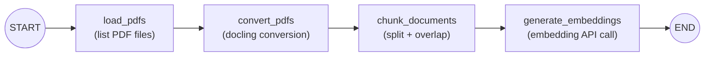
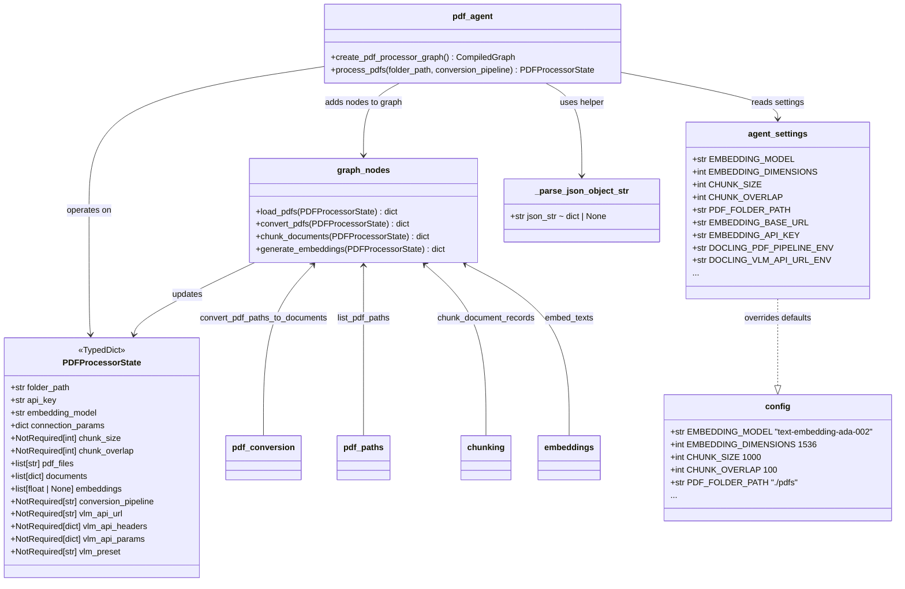

# PDF Processing Agent

LangGraph workflow that discovers PDFs, converts them with **docling**, chunks text with overlap, and requests **OpenAI-compatible** embeddings per chunk.

## Setup

1. **Python 3.11+** and [uv](https://docs.astral.sh/uv/) (recommended).

2. Install dependencies:

   ```bash
   uv sync
   ```

3. **Environment** (shell or `.env` loaded by your entry script; the library does not auto-load `.env`):

   - `EMBEDDING_API_KEY`: API key for the embedding endpoint (or `OPENAI_API_KEY` as fallback)
   - `EMBEDDING_BASE_URL`: Base URL of the OpenAI-compatible API (optional; omit for the default OpenAI host)
   - `PDF_FOLDER_PATH`: Folder containing PDFs (optional; see defaults below)

## Usage

```python
from src.pdf_agent import process_pdfs

result = process_pdfs("./path/to/pdf/folder")
# TypedDict PDFProcessorState: folder_path, pdf_files, documents, embeddings
chunks = result["documents"]
vectors = result["embeddings"]
```

CLI (uses `PDF_FOLDER_PATH` from the environment or the configured default):

```bash
uv run python -m src.pdf_agent
```

## Architecture

### Workflow Graph



### Class Diagram



- **Entry point** (`src/pdf_agent.py`): `StateGraph(PDFProcessorState)` wired as `load_pdfs → convert_pdfs → chunk_documents → generate_embeddings` → `END`.
- **State** (`src/graph/graph_state.py`): `PDFProcessorState` TypedDict with `folder_path`, `pdf_files`, `documents`, `embeddings`, VLM/patching params, etc.
- **Nodes** (`src/graph/graph_nodes.py`): four callables — `load_pdfs`, `convert_pdfs`, `chunk_documents`, `generate_embeddings` — each returning a dict that merges into state.
- **Helpers** (`src/graph/pdf_paths.py`, `pdf_conversion.py`, `chunking.py`, `embeddings.py`): path discovery, docling conversion (standard or VLM), text splitting, and embedding API calls.
- **Configuration** (`src/setup/config.py` → `src/setup/agent_settings.py`): defaults from `config.py`, resolved with `.env` → `os.environ` overrides via `_str_setting`, `_int_setting`, `_strip_or_none`.
- **Utils** (`src/utils/_parse_json_object_str`): helper to parse JSON env var strings into dicts for VLM headers/params.

## Workflow

1. **Load PDFs**: `*.pdf` under the folder (`src/graph/pdf_paths.py`).
2. **Convert PDFs**: Each file becomes a record with `content` (full text) and `metadata` (`file_path`, `file_name`, `page_count`, `title`). Per-file failures are printed; successful files are still returned.
3. **Chunk documents**: Split each document's `content` using `CHUNK_SIZE` and `CHUNK_OVERLAP`; metadata gains `chunk_index` and `chunk_count`.
4. **Generate embeddings**: One embedding per chunk via `EMBEDDING_MODEL`; per-chunk API errors print and yield `None` at that index.

## Dependencies

Declared in `pyproject.toml`:

- `langgraph>=1.2.0`
- `docling>=2.93.0`
- `openai>=1.14.0`
- `python-dotenv>=1.2.2`

## Configuration (`src/config.py`)

| Setting | Role |
|--------|------|
| `PDF_FOLDER_PATH` | Default folder when `process_pdfs()` is called with no path |
| `CHUNK_SIZE` | Characters per chunk (default 1000) |
| `CHUNK_OVERLAP` | Overlap between consecutive chunks (default 100) |
| `EMBEDDING_MODEL` | Model id passed to the embeddings API |
| `EMBEDDING_DIMENSIONS` | Documented expected vector size for the chosen model (1536 for the default ada-002 style setup) |
