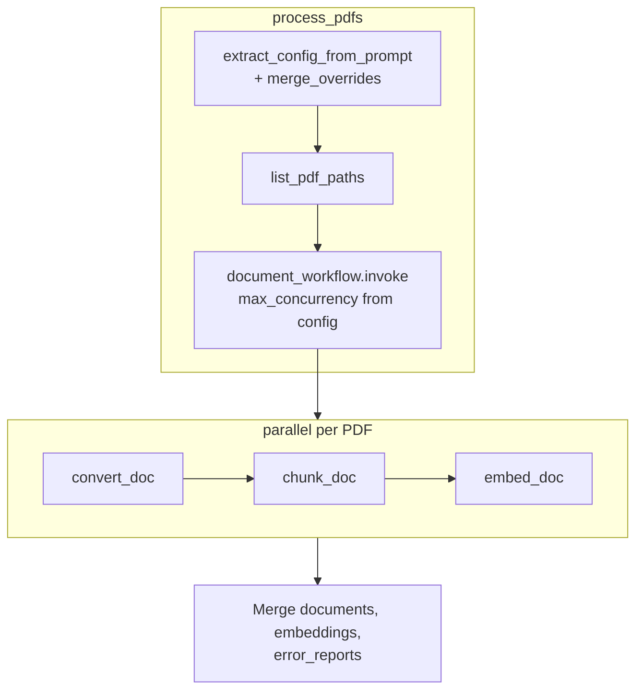
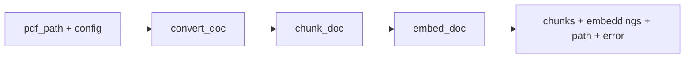
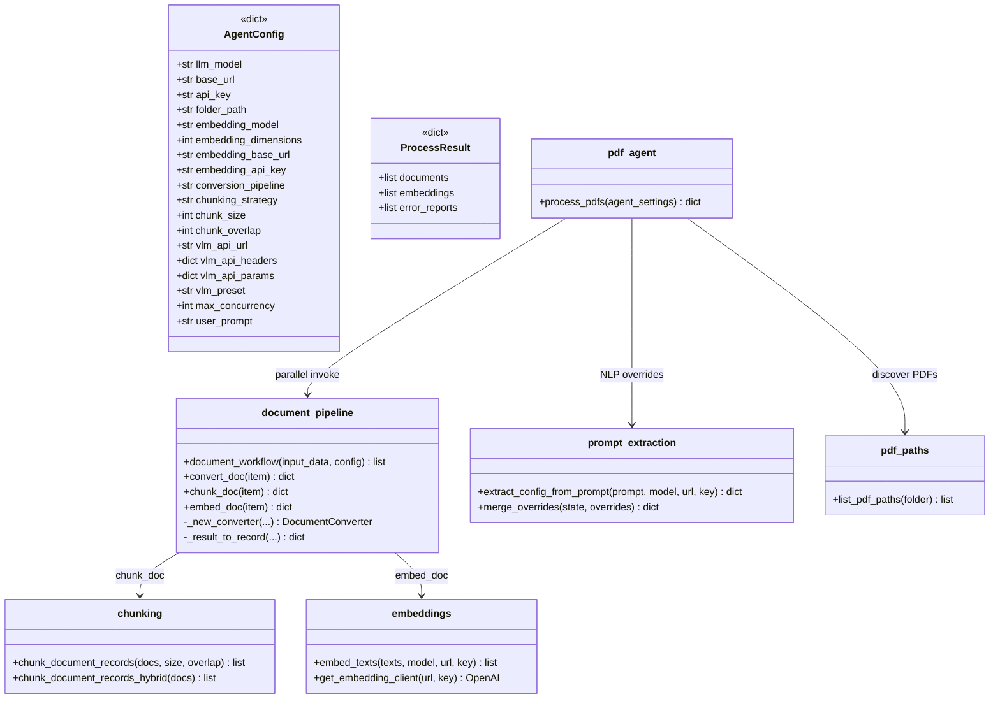

# PDF Processing Agent

LangGraph workflow that discovers PDFs, converts them in **parallel** with **docling**, chunks text with overlap, and requests **OpenAI-compatible** embeddings per chunk.

## Setup

1. **Python 3.11+** and [uv](https://docs.astral.sh/uv/) (recommended).

2. Install dependencies:

   ```bash
   uv sync
   ```

3. **Environment**: Create a `.env` file in the project root (see `.env` for the full list of configurable variables). All settings can also be overridden via shell environment variables.

## Usage

```python
from src.setup import load_environment_variables
from src.pdf_agent import process_pdfs

agent_settings = load_environment_variables(".env")
# or pass a config dict directly:
# agent_settings = {
#     "folder_path": "./pdfs",
#     "user_prompt": "Use VLM pipeline and hybrid chunking with 500 char chunks",  # optional NLP extraction
#     "embedding_model": "text-embedding-ada-002",
#     "embedding_dimensions": 1536,
#     "embedding_base_url": "https://api.openai.com/v1",
#     "embedding_api_key": "your-api-key-here",
#     "conversion_pipeline": "standard",  # or "vlm"
#     "chunking_strategy": "fixed",        # or "hybrid"
#     "chunk_size": 1000,
#     "chunk_overlap": 100,
#     "max_concurrency": 4,
# }

result = process_pdfs(agent_settings)
# result is a dict with keys:
#   documents      — list of chunk records (content + metadata)
#   embeddings     — list[list[float] | None], one per chunk
#   error_reports  — list of {"path", "error"} for files that failed
chunks = result["documents"]
vectors = result["embeddings"]
if result.get("error_reports"):
    for err in result["error_reports"]:
        print(f"Failed: {err['path']}: {err['error']}")
```

CLI (uses `FOLDER_PATH` and other variables from the `.env` file or the configured defaults):

```bash
uv run python -m src.pdf_agent
# Custom env file:
uv run python -m src.pdf_agent --envfile .env.local
# User prompt for NLP extraction:
uv run python -m src.pdf_agent --user_prompt "Use VLM pipeline and hybrid chunking"
```

## Environment Variables

| Variable | Default | Role |
|---|---|---|
| `FOLDER_PATH` | `./pdfs` | Directory containing PDF files to process |
| `EMBEDDING_API_KEY` | `your-api-key-here` | API key for the embedding endpoint |
| `EMBEDDING_BASE_URL` | `https://api.openai.com/v1` | Base URL of the OpenAI-compatible API |
| `EMBEDDING_MODEL` | `text-embedding-ada-002` | Model id passed to the embeddings API |
| `EMBEDDING_DIMENSIONS` | `1536` | Expected vector size for the chosen model |
| `CHUNK_SIZE` | `1000` | Characters per fixed-size chunk |
| `CHUNK_OVERLAP` | `100` | Overlap between consecutive fixed-size chunks |
| `CONVERSION_PIPELINE` | `standard` | `standard` (docling pipeline) or `vlm` (VLM pipeline) |
| `CHUNKING_STRATEGY` | `fixed` | `fixed` (character-based) or `hybrid` (document-aware) |
| `LLM_MODEL` | `gpt-4o-mini` | LLM model for NLP extraction |
| `BASE_URL` | `https://api.openai.com/v1` | Base URL for the LLM |
| `API_KEY` | `your-api-key-here` | API key for the LLM |
| `VLM_API_URL` | `https://api.openai.com/v1` | Remote VLM endpoint URL (required when `CONVERSION_PIPELINE=vlm`) |
| `VLM_API_HEADERS` | `{}` | JSON object of headers for the VLM API |
| `VLM_API_PARAMS` | `{}` | JSON object of params for the VLM API |
| `VLM_PRESET` | `smoldocling` | Preset name for the VLM conversion |
| `MAX_CONCURRENCY` | CPU count (`os.cpu_count()`) | Max parallel PDF pipelines |

## Architecture

### Top-level orchestration (`process_pdfs`)



### Per-document pipeline (`document_workflow`)



Each PDF gets its own `DocumentConverter` instance inside `convert_doc` (no shared singleton). Tasks are defined with `langgraph.func` (`@task`, `@entrypoint`) in `src/graph/document_pipeline.py`.

### Schema



### Module structure

| Module | Role |
|--------|------|
| [`src/pdf_agent.py`](src/pdf_agent.py) | `process_pdfs`, CLI — orchestrates NLP extraction, PDF discovery, pipeline invoke, result merge |
| [`src/graph/document_pipeline.py`](src/graph/document_pipeline.py) | `@task` / `@entrypoint` parallel pipeline: `convert_doc` → `chunk_doc` → `embed_doc` |
| [`src/graph/chunking.py`](src/graph/chunking.py) | `chunk_document_records` (fixed-size on markdown `content`); `chunk_document_records_hybrid` (uses `docling_document` + `HybridChunker.contextualize`) |
| [`src/graph/embeddings.py`](src/graph/embeddings.py) | `embed_texts`, singleton `get_embedding_client` |
| [`src/graph/prompt_extraction.py`](src/graph/prompt_extraction.py) | `extract_config_from_prompt`, `merge_overrides` |
| [`src/graph/prompts/extractor.py`](src/graph/prompts/extractor.py) | System prompt; 15 NLP-extractable keys in `_CONFIG_KEYS` (`vlm_api_params` is env-only) |
| [`src/graph/pdf_paths.py`](src/graph/pdf_paths.py) | `list_pdf_paths` — glob `*.pdf` under a folder |
| [`src/setup/agent_settings.py`](src/setup/agent_settings.py) | `load_environment_variables` — `.env` via `python-dotenv` |
| [`src/utils/json_parse.py`](src/utils/json_parse.py) | `_parse_json_object_str` for VLM headers/params env vars |

Removed modules (do not reference): `graph_state.py`, `graph_nodes.py`, `pdf_conversion.py`, `create_pdf_processor_graph`.

## Workflow

1. **Extract config** (`src/graph/prompt_extraction.py`): If `user_prompt` is set, an LLM extracts overrides into a dict; `merge_overrides` applies non-`None` values to the config dict. Unextractable keys keep `.env` defaults.
2. **Load PDFs** (`src/graph/pdf_paths.py`): `list_pdf_paths(folder_path)` returns paths for all `*.pdf` files.
3. **Parallel pipeline** (`src/graph/document_pipeline.py`):
   - **Convert** (`convert_doc`): Fresh `DocumentConverter` per task via `_new_converter`. Standard or VLM pipeline. Output record: `content` (markdown), `docling_document`, `metadata` (`file_path`, `file_name`, `page_count`, `title`, `conversion_pipeline`). Errors return `doc: None` and an `error` string.
   - **Chunk** (`chunk_doc`): `fixed` chunks markdown `content` with `chunk_size`/`chunk_overlap`; `hybrid` chunks `docling_document` via docling `HybridChunker`. Metadata extended with `chunk_index`, `chunk_count`.
   - **Embed** (`embed_doc`): One embedding per chunk via `embed_texts`; per-chunk API errors yield `None` at that index.
   - Concurrency: `document_workflow.invoke(..., config={"configurable": {"max_concurrency": N}})`.
4. **Aggregate** (`src/pdf_agent.py`): Flatten all chunks into `documents`, all vectors into `embeddings`, collect failures into `error_reports`.

## Conventions for agents

- **Entry point**: `process_pdfs(agent_settings: dict) -> dict`. Config is a plain dict throughout; there is no `PDFProcessorState` TypedDict or compiled `StateGraph`.
- **Extend the pipeline** by adding or modifying `@task` functions in `document_pipeline.py`, not by wiring LangGraph nodes in a central graph.
- **Per-file isolation**: Conversion failures do not abort other PDFs; check `error_reports` in the result.
- **Hybrid chunking** requires `docling_document` on the conversion record; fixed chunking uses markdown `content`.
- **NLP extraction** covers 15 keys (`_CONFIG_KEYS` in `extractor.py`); `vlm_api_params` is only set via env/config dict, not the LLM extractor.

## Dependencies

Declared in `pyproject.toml`:

- `docling>=2.93.0`
- `langgraph>=1.2.0`
- `openai>=2.30.0`
- `python-dotenv>=1.2.2`

## License

GPL-3

## AI Disclosure

This project has been developed with the help of an AI Model. Specifically an instance of Qwen3.6-35B-A3B running in vLLM
