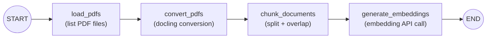
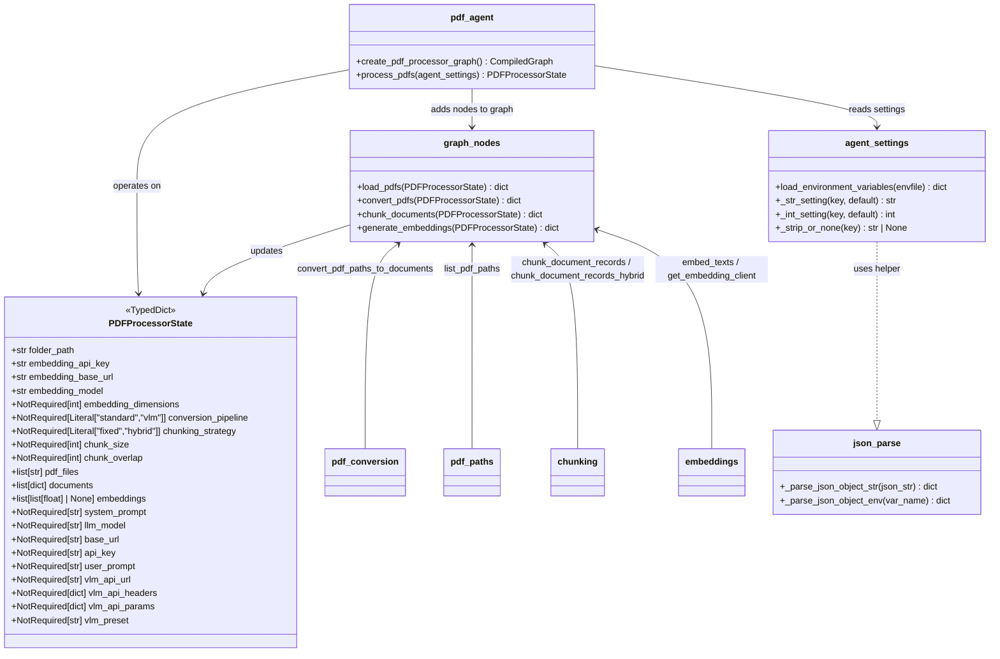

# PDF Processing Agent

LangGraph workflow that discovers PDFs, converts them with **docling**, chunks text with overlap, and requests **OpenAI-compatible** embeddings per chunk.

## Setup

1. **Python 3.11+** and [uv](https://docs.astral.sh/uv/) (recommended).

2. Install dependencies:

   ```bash
   uv sync
   ```

3. **Environment**: Create a `.env` file in the project root (see `.env` for the full list of configurable variables). All settings can also be overridden via shell environment variables.

## Usage

```python
from src.setup import load_environment_variables
from src.pdf_agent import process_pdfs

agent_settings = load_environment_variables(".env")
# or pass a config dict directly:
# agent_settings = {
#     "folder_path": "./pdfs",
#     "embedding_model": "text-embedding-ada-002",
#     "embedding_dimensions": 1536,
#     "embedding_base_url": "https://api.openai.com/v1",
#     "embedding_api_key": "your-api-key-here",
#     "conversion_pipeline": "standard",  # or "vlm"
#     "chunking_strategy": "fixed",        # or "hybrid"
#     "chunk_size": 1000,
#     "chunk_overlap": 100,
# }

result = process_pdfs(agent_settings)
# result is PDFProcessorState (TypedDict) with keys:
# folder_path, pdf_files, documents, embeddings, ...
chunks = result["documents"]
vectors = result["embeddings"]   # list[list[float] | None]
```

CLI (uses `FOLDER_PATH` and other variables from the `.env` file or the configured defaults):

```bash
uv run python -m src.pdf_agent
# Custom env file:
uv run python -m src.pdf_agent --envfile .env.local
```

## Environment Variables

| Variable | Default | Role |
|---|---|---|
| `FOLDER_PATH` | `./pdfs` | Directory containing PDF files to process |
| `EMBEDDING_API_KEY` | `your-api-key-here` | API key for the embedding endpoint |
| `EMBEDDING_BASE_URL` | `https://api.openai.com/v1` | Base URL of the OpenAI-compatible API |
| `EMBEDDING_MODEL` | `text-embedding-ada-002` | Model id passed to the embeddings API |
| `EMBEDDING_DIMENSIONS` | `1536` | Expected vector size for the chosen model |
| `CHUNK_SIZE` | `1000` | Characters per fixed-size chunk |
| `CHUNK_OVERLAP` | `100` | Overlap between consecutive fixed-size chunks |
| `CONVERSION_PIPELINE` | `standard` | `standard` (docling pipeline) or `vlm` (VLM pipeline) |
| `CHUNKING_STRATEGY` | `fixed` | `fixed` (character-based) or `hybrid` (document-aware) |
| `SYSTEM_PROMPT` | `""` | System prompt for optional LLM preprocessing |
| `LLM_MODEL` | `gpt-4o-mini` | LLM model for optional preprocessing |
| `BASE_URL` | `https://api.openai.com/v1` | Base URL for the LLM |
| `API_KEY` | `your-api-key-here` | API key for the LLM |
| `VLM_API_URL` | `https://api.openai.com/v1` | Remote VLM endpoint URL (required when `CONVERSION_PIPELINE=vlm`) |
| `VLM_API_HEADERS` | `{}` | JSON object of headers for the VLM API |
| `VLM_API_PARAMS` | `{}` | JSON object of params for the VLM API |
| `VLM_PRESET` | `smoldocling` | Preset name for the VLM conversion |

## Architecture

### Workflow Graph



### State Schema



### Module Structure

- **Entry point** (`src/pdf_agent.py`): `StateGraph(PDFProcessorState)` wired as `load_pdfs → convert_pdfs → chunk_documents → generate_embeddings` → `END`. Public function `process_pdfs(agent_settings)` runs the compiled graph.
- **State** (`src/graph/graph_state.py`): `PDFProcessorState` TypedDict with embedding settings, pipeline config, discovered files, documents, and embeddings.
- **Nodes** (`src/graph/graph_nodes.py`): four callables — `load_pdfs`, `convert_pdfs`, `chunk_documents`, `generate_embeddings` — each returning a dict that merges into state.
- **Helpers**:
  - `src/graph/pdf_paths.py`: `list_pdf_paths()` — glob `*.pdf` under a folder.
  - `src/graph/pdf_conversion.py`: `convert_pdf_paths_to_documents()` — standard docling or VLM pipeline with caching.
  - `src/graph/chunking.py`: `chunk_document_records()` (fixed-size) and `chunk_document_records_hybrid()` (docling `HybridChunker`).
  - `src/graph/embeddings.py`: `embed_texts()` (per-chunk with error handling) and singleton `get_embedding_client()`.
- **Configuration** (`src/setup/agent_settings.py`): `load_environment_variables(envfile)` — `.env` via `python-dotenv`, resolved with `_str_setting`, `_int_setting`, `_strip_or_none`.
- **Utils** (`src/utils/json_parse.py`): `_parse_json_object_str` and `_parse_json_object_env` helpers for parsing JSON env var strings into dicts (used for VLM headers/params).

## Workflow

1. **Load PDFs** (`src/graph/pdf_paths.py`): Discover `*.pdf` files in `FOLDER_PATH`.
2. **Convert PDFs** (`src/graph/pdf_conversion.py`): Each file becomes a record with `content` (Markdown text), `docling_document`, and `metadata` (`file_path`, `file_name`, `page_count`, `title`, `conversion_pipeline`). Supports `standard` (default) or `vlm` pipelines. Per-file failures are printed; successful files are still returned.
3. **Chunk documents** (`src/graph/chunking.py`): Splits documents using the `CHUNKING_STRATEGY` — `fixed` uses character-based splitting with `CHUNK_SIZE`/`CHUNK_OVERLAP`; `hybrid` uses docling's `HybridChunker`. Each chunk record extends `metadata` with `chunk_index` and `chunk_count`.
4. **Generate embeddings** (`src/graph/embeddings.py`): One embedding vector per chunk via `EMBEDDING_MODEL`; per-chunk API errors print and yield `None` at that index.

## Dependencies

Declared in `pyproject.toml`:

- `docling>=2.93.0`
- `langgraph>=1.2.0`
- `openai>=2.30.0`
- `python-dotenv>=1.2.2`

## License

GPL-3

## AI Disclosure

This project has been developed with the help of an AI Model. Specifically an instance of Qwen3.6-35B-A3B running in vLLM
