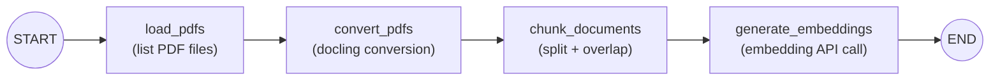
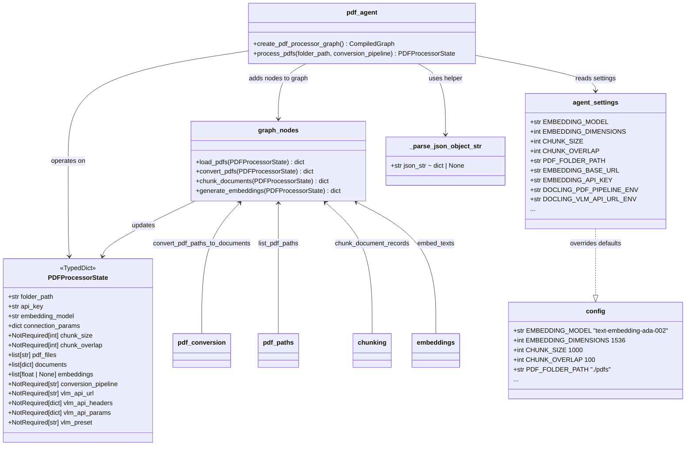

# PDF Processing Agent

A multi-step workflow built with **LangGraph** that processes PDF files using **docling** for conversion and an **OpenAI-compatible** HTTP API for embeddings.

## Requirements

- Python **3.11+**
- [uv](https://docs.astral.sh/uv/) (recommended) or another PEP 517 installer

## Features

- Load PDF files from a specified folder
- Convert PDFs to text using docling
- Chunk documents into smaller parts (size and overlap are configured in `src/config.py`)
- Generate embeddings for each chunk via an OpenAI-compatible embeddings endpoint

## Installation

```bash
uv sync
```

## Setup

1. Configure environment variables (for example in a `.env` file in the project root). The embedding client reads:

   - `EMBEDDING_API_KEY`: API key for the embedding endpoint (or `OPENAI_API_KEY` as a fallback)
   - `EMBEDDING_BASE_URL`: Base URL of the OpenAI-compatible embedding API (optional; omit for the default OpenAI host)
   - `PDF_FOLDER_PATH`: Directory containing PDF files to process (optional; defaults to `./pdfs` in `src/config.py`)

   If you use a `.env` file, load it from your own script (for example `from dotenv import load_dotenv; load_dotenv()`), or export the variables in your shell before running.

2. Put PDFs in that folder (or point `PDF_FOLDER_PATH` at an existing folder).

## Usage

```python
from src.pdf_agent import process_pdfs

result = process_pdfs("./path/to/pdf/folder")
# result is a dict (TypedDict) with keys:
# folder_path, pdf_files, documents, embeddings
chunks = result["documents"]
vectors = result["embeddings"]
```

Run the bundled entrypoint (uses `PDF_FOLDER_PATH` from the environment or the default folder):

```bash
uv run python -m src.pdf_agent
```

## Workflow

The LangGraph pipeline runs these steps in order:

1. **Load PDFs**: Discover `*.pdf` files in the folder
2. **Convert PDFs**: Turn each file into text (and basic metadata) with docling
3. **Chunk documents**: Split text into overlapping chunks
4. **Generate embeddings**: Call the embeddings API for each chunk (requires a valid API key when this step runs)

## Dependencies

Declared in `pyproject.toml`:

- `langgraph` (1.2+)
- `docling` (2.93+)
- `openai` (1.14+)
- `python-dotenv` (1.2+)

## Architecture

### Workflow Graph



### Class Diagram



<!-- existing dependency section for completeness -->
## Dependencies

Declared in `pyproject.toml`:

- `langgraph` (1.2+)
- `docling` (2.93+)
- `openai` (1.14+)
- `python-dotenv` (1.2+)

## License

GPL-3

## AI Disclosure

This project has been developed with the help of an AI Model. Specifically an instance of Qwen3.6-35B-A3B running in vLLM
