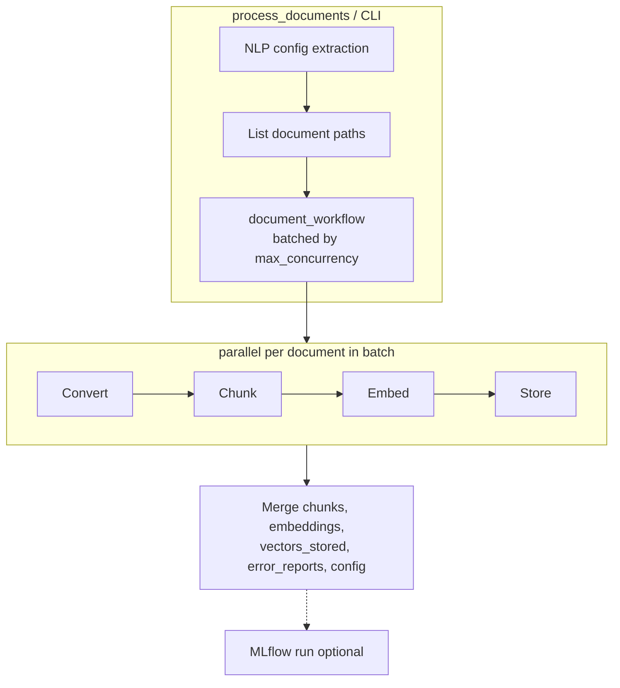

# Docling Document Processing Agent

LangGraph workflow that discovers documents (PDF, DOCX, XLSX, Markdown, HTML, LaTeX), converts them in **parallel batches** with **docling**, chunks text with overlap, requests **OpenAI-compatible** embeddings per chunk, and optionally persists vectors to **Chroma** or **Milvus** via LangChain connectors. Optional **MLflow** tracing records runs, spans, and metrics when enabled.

## Setup

1. **Python 3.11+** and [uv](https://docs.astral.sh/uv/) (recommended).

2. Install dependencies:

   ```bash
   uv sync
   # Optional vector DB backends:
   uv sync --extra chroma
   uv sync --extra milvus
   uv sync --extra vector-stores
   ```

   Install the matching extra before setting `VECTOR_STORE_BACKEND` to `chroma` or `milvus`.

3. **Environment**: Create a `.env` file in the project root (see `.env` for the full list of configurable variables). All settings can also be overridden via shell environment variables.

4. **MLflow (optional)**: When `ENABLE_TRACING=1`, start an MLflow tracking server (default `MLFLOW_TRACKING_URI=http://localhost:5000`) and open the experiment named in `MLFLOW_EXPERMENT_NAME` (default **Docling Agent**) to inspect runs. Pipeline worker modules read `ENABLE_TRACING` from the environment at import time, so load `.env` (or export the variable) before importing graph modules if per-task spans should include `store_doc`.

## Usage

```python
from src.setup import load_environment_variables
from src.docling_agent import process_documents

agent_settings = load_environment_variables(".env")
# or pass a config dict directly:
# agent_settings = {
#     "folder_path": "./pdfs",
#     "user_prompt": "Use VLM pipeline and hybrid chunking with 500 char chunks",  # optional NLP extraction
#     "embedding_model": "text-embedding-ada-002",
#     "embedding_dimensions": 1536,
#     "embedding_base_url": "https://api.openai.com/v1",
#     "embedding_api_key": "your-api-key-here",
#     "conversion_pipeline": "standard",  # or "vlm" (PDF only)
#     "chunking_strategy": "fixed",        # or "hybrid"
#     "chunk_size": 1000,
#     "chunk_overlap": 100,
#     "max_concurrency": 4,
#     "vector_store_backend": "none",      # or "chroma", "milvus" (requires matching uv extra)
#     "vector_store_collection": "docling_chunks",
#     # Chroma/Milvus connection settings (CHROMA_*, MILVUS_*) are env-only, not NLP-extracted
#     "enable_tracing": 0,
#     "mlflow_tracking_uri": "http://localhost:5000",
#     "mlflow_experiment_name": "Docling Agent",
# }

result = process_documents(agent_settings)
# result merges resolved agent_settings with:
#   documents      — list of chunk records (content + metadata)
#   embeddings     — list[list[float] | None], one per chunk
#   vectors_stored — count of chunk vectors written when vector_store_backend is chroma/milvus
#   error_reports  — list of {"path", "error", "stage"} for pipeline or vector_store failures
chunks = result["documents"]
vectors = result["embeddings"]
backend = (result.get("vector_store_backend") or "none").lower()
if backend != "none":
    print(f"Vectors stored in {backend}: {result.get('vectors_stored', 0)}")
if result.get("error_reports"):
    for err in result["error_reports"]:
        print(f"Failed ({err.get('stage', 'pipeline')}): {err['path']}: {err['error']}")
```

CLI (uses `FOLDER_PATH` and other variables from the `.env` file or the configured defaults):

```bash
uv run python -m src.docling_agent
# Custom env file:
uv run python -m src.docling_agent --envfile .env.local
# User prompt for NLP extraction:
uv run python -m src.docling_agent --user_prompt "Use VLM pipeline and hybrid chunking"
```

With `ENABLE_TRACING=1`, the CLI connects to `mlflow_tracking_uri`, uses `mlflow_experiment_name`, and starts a uniquely named run (`docling_pdf_processing_{timestamp}_{uuid}` via `generate_mlflow_run_name`). All traces from that invocation are grouped under one MLflow session (default: the run’s `run_id`; override with `MLFLOW_SESSION_ID`). It logs sanitized config params, workflow spans (NLP extraction, document discovery, pipeline, aggregation), metrics (`document_count`, `total_chunks`, `total_embeddings`, `vectors_stored`, `error_count`, `vector_store_error_count`, `non_null_embeddings`), and writes `error_reports.json` when any file fails. When a vector store backend is configured, the CLI also prints `Vectors stored in {backend}: N`. Per-document tasks also emit spans when `ENABLE_TRACING` is set in the environment before worker modules load.

## Environment Variables

| Variable | Default | Role |
|---|---|---|
| `FOLDER_PATH` | `./pdfs` | Directory containing documents to process |
| `EMBEDDING_API_KEY` | `your-api-key-here` | API key for the embedding endpoint |
| `EMBEDDING_BASE_URL` | `https://api.openai.com/v1` | Base URL of the OpenAI-compatible API |
| `EMBEDDING_MODEL` | `text-embedding-ada-002` | Model id passed to the embeddings API |
| `EMBEDDING_DIMENSIONS` | `1536` | Expected vector size for the chosen model |
| `CHUNK_SIZE` | `1000` | Characters per fixed-size chunk |
| `CHUNK_OVERLAP` | `100` | Overlap between consecutive fixed-size chunks |
| `CONVERSION_PIPELINE` | `standard` | `standard` (multi-format docling pipeline) or `vlm` (PDF only) |
| `CHUNKING_STRATEGY` | `fixed` | `fixed` (character-based) or `hybrid` (document-aware) |
| `LLM_MODEL` | `gpt-4o-mini` | LLM model for NLP extraction |
| `BASE_URL` | `https://api.openai.com/v1` | Base URL for the LLM |
| `API_KEY` | `your-api-key-here` | API key for the LLM |
| `VLM_API_URL` | `https://api.openai.com/v1` | Remote VLM endpoint URL (required when `CONVERSION_PIPELINE=vlm`) |
| `VLM_API_HEADERS` | `{}` | JSON object of headers for the VLM API |
| `VLM_API_PARAMS` | `{}` | JSON object of params for the VLM API |
| `VLM_PRESET` | `smoldocling` | Preset name for the VLM conversion |
| `MAX_CONCURRENCY` | CPU count (`os.cpu_count()`) | Max documents processed in parallel per batch |
| `ENABLE_TRACING` | `0` | Set to `1` to enable MLflow tracing in the CLI and pipeline modules |
| `MLFLOW_TRACKING_URI` | `http://localhost:5000` | MLflow tracking server URL (CLI tracing path) |
| `MLFLOW_EXPERIMENT_NAME` | `Docling Agent` | MLflow experiment name |
| `MLFLOW_SESSION_ID` | _(unset)_ | Optional trace session id; CLI default is the active run’s `run_id` |
| **Vector Store Configuration** | | |
| `VECTOR_STORE_BACKEND` | `none` | `none`, `chroma`, or `milvus` (opt-in persistence) |
| `VECTOR_STORE_COLLECTION` | `docling_chunks` | Collection name in Chroma/Milvus |
| `VECTOR_STORE_WRITE_MODE` | `insert` | Write behavior: `insert`, `upsert`, or `skip_existing` |
| `VECTOR_STORE_BATCH_SIZE` | `200` | Max vectors per insert sub-batch |
| `VECTOR_STORE_MAX_BATCH_WORKERS` | `4` | Number of parallel batch workers |
| **Vector Store Resilience** | | |
| `VECTOR_STORE_RETRY_ATTEMPTS` | `3` | Max retries for transient failures |
| `VECTOR_STORE_RETRY_BACKOFF_MULTIPLIER` | `1` | Exponential backoff multiplier |
| `VECTOR_STORE_CIRCUIT_BREAKER_THRESHOLD` | `5` | Failures before circuit opens |
| `VECTOR_STORE_CIRCUIT_BREAKER_TIMEOUT` | `60` | Seconds before retry after circuit open |
| **ChromaDB Configuration** | | |
| `CHROMA_HOST` | _(unset)_ | Remote Chroma server host (optional) |
| `CHROMA_PORT` | `8000` | Remote Chroma server port |
| `CHROMA_PERSIST_DIRECTORY` | _(unset)_ | Local Chroma persistence directory |
| `CHROMA_DISTANCE_FUNCTION` | `cosine` | Distance metric: `l2`, `cosine`, `ip` |
| `CHROMA_COLLECTION_METADATA` | `{}` | JSON object of collection metadata |
| `CHROMA_ALLOW_RESET` | `0` | Enable collection reset for testing |
| **Milvus Configuration** | | |
| `MILVUS_URI` | `http://localhost:19530` | Milvus server URI or Milvus Lite file path |
| `MILVUS_TOKEN` | _(unset)_ | Milvus auth token |
| `MILVUS_DB_NAME` | `default` | Milvus database name |
| `MILVUS_INDEX_TYPE` | `HNSW` | Index type: `IVF_FLAT`, `HNSW`, `DISKANN` |
| `MILVUS_METRIC_TYPE` | `COSINE` | Similarity metric: `L2`, `IP`, `COSINE` |
| `MILVUS_INDEX_PARAMS` | `{}` | JSON object of index parameters |
| `MILVUS_CONSISTENCY_LEVEL` | `Bounded` | Consistency level: `Strong`, `Bounded`, `Eventually` |
| `MILVUS_PARTITION_NAME` | _(unset)_ | Optional partition name |

Vector persistence uses **precomputed** embeddings from the pipeline (no second embed call). Chunk IDs are stable: `{file_path}#chunk_{chunk_index}`. Chroma/Milvus connection settings are env-only and are not extracted from natural-language prompts.

## Vector Store CRUD Operations

The vector store module now supports full CRUD (Create, Read, Update, Delete) operations:

### Insert (Create)
```python
from src.graph.vector_store import get_or_create_vector_store, store_chunk_embeddings

vector_store = get_or_create_vector_store(config)
result = store_chunk_embeddings(
    vector_store,
    chunks,
    embeddings,
    batch_size=200,
    write_mode="insert",  # Default: creates new records
    max_workers=4,        # Parallel batch processing
    config=config,
)
print(f"Stored: {result['stored_count']}, Skipped: {result['skipped_count']}")
```

### Upsert (Update or Insert)
```python
# Upsert mode: updates existing records or inserts new ones
result = store_chunk_embeddings(
    vector_store,
    chunks,
    embeddings,
    write_mode="upsert",  # Deletes existing IDs, then inserts
    config=config,
)
print(f"Upserted: {result['upserted_count']}")
```

### Query (Read)
```python
from src.graph.vector_store import query_vector_store

results = query_vector_store(
    vector_store,
    query="What is machine learning?",
    k=5,  # Number of results
    metadata_filter={"file_path": "/path/to/doc.pdf"},  # Optional filter
    embedding_config={
        "embedding_model": "text-embedding-ada-002",
        "embedding_base_url": "https://api.openai.com/v1",
        "embedding_api_key": "your-key",
    },
    config=config,
)

for result in results:
    print(f"Content: {result['content']}")
    print(f"Metadata: {result['metadata']}")
    print(f"Score: {result['score']}")
```

### Delete
```python
from src.graph.vector_store import delete_chunk_embeddings

# Delete by specific chunk IDs
result = delete_chunk_embeddings(
    vector_store,
    ids=["file.pdf#chunk_0", "file.pdf#chunk_1"],
    config=config,
)

# Delete all chunks from a document
result = delete_chunk_embeddings(
    vector_store,
    file_paths=["/path/to/doc.pdf"],
    config=config,
)

# Delete by metadata filter
result = delete_chunk_embeddings(
    vector_store,
    metadata_filters={"conversion_pipeline": "old_version"},
    config=config,
)
print(f"Deleted: {result['deleted_count']}")
```

### Higher-Level Operations
```python
from src.graph.vector_operations import delete_document, replace_document_chunks

# Delete all chunks from a document
delete_document(vector_store, "/path/to/doc.pdf", config)

# Replace document with updated version
replace_document_chunks(
    vector_store,
    "/path/to/doc.pdf",
    new_chunks,
    new_embeddings,
    config,
)
```

### Write Modes

- **`insert`** (default): Creates new records. Behavior on duplicate IDs is backend-dependent
- **`upsert`**: Deletes existing records with matching IDs, then inserts (idempotent)
- **`skip_existing`**: Only inserts chunks with IDs that don't already exist

### Performance Features

- **Connection pooling**: Vector store instances are cached and reused across calls
- **Parallel batch processing**: Configurable worker threads for concurrent batch inserts
- **Retry with exponential backoff**: Automatic retry for transient failures (connection errors, timeouts)
- **Circuit breaker**: Prevents cascading failures when vector store is unavailable
- **Enhanced metrics**: MLflow tracing includes throughput, retry counts, batch durations

## Supported formats

| Pipeline | Formats |
|---|---|
| `standard` | PDF, DOCX, XLSX, Markdown (`.md`), HTML, LaTeX (`.latex`, `.tex`) |
| `vlm` | PDF only (non-PDF files fall back to the standard pipeline) |

Discovery globs in `list_document_paths` match the standard pipeline set above.

## Architecture

Agent and contributor details: see [AGENTS.md](AGENTS.md).



## Workflow

1. **Extract config** (optional): If a `user_prompt` is provided (via CLI `--user_prompt` or the `user_prompt` config field), an LLM extracts configuration overrides. Unextractable parameters keep their `.env` defaults.
2. **Load documents**: Discover supported files in `FOLDER_PATH` via `list_document_paths`.
3. **Process in batches**: Documents are handled in groups of up to `MAX_CONCURRENCY`. Within each batch, convert → chunk → embed → store run in parallel for every file in that batch; the next batch starts when the current one finishes. The store step is skipped when `vector_store_backend` is `none`. Conversion supports `standard` (multi-format) or `vlm` (PDF only); chunking supports `fixed` (character-based with `CHUNK_SIZE`/`CHUNK_OVERLAP`) or `hybrid` (docling `HybridChunker`).
4. **Aggregate results**: All chunks and embeddings are merged into `documents` and `embeddings`, with `vectors_stored` summing successful writes. Per-file failures are collected in `error_reports` with `stage` of `pipeline` or `vector_store`, without stopping other files. The returned dict also includes the resolved agent settings (e.g. `folder_path`, `chunking_strategy`) except `documents` and `embeddings`.

## MLflow tracing

| When | What is recorded |
|---|---|
| CLI with `enable_tracing` / `ENABLE_TRACING=1` | Top-level run, LangChain/OpenAI autolog, workflow spans, metrics, `error_reports.json` artifact |
| Pipeline modules (`ENABLE_TRACING=1` in env) | Spans on convert, chunk, embed, store (`store_doc`), document listing, and chunking helpers |

**Session grouping:** The CLI sets `mlflow_session_id` to `MLFLOW_SESSION_ID` or the active run’s `run_id`, wraps the instrumented workflow in `mlflow.tracing.context(session_id=...)`, and passes the id in per-document config so parallel tasks tag traces the same way. Filter in the MLflow UI: ``metadata.`mlflow.trace.session` = '<session_id>'``.

Sensitive values are not logged as MLflow params: `api_key`, `embedding_api_key`, `vlm_api_headers`, `vlm_api_params`.

Configure the tracking server and experiment via `MLFLOW_TRACKING_URI` and `MLFLOW_EXPERMENT_NAME` in `.env` (mapped to `mlflow_tracking_uri` and `mlflow_experiment_name` in the config dict). Pass `enable_tracing=True` to `process_documents()` to start a top-level MLflow run; the config dict key alone does not enable tracing unless you pass the flag (the CLI maps `enable_tracing` from settings).

## Module structure

- `src/docling_agent.py` — entry point (`process_documents`, CLI, optional MLflow orchestration)
- `src/graph/document_pipeline.py` — batched parallel per-document convert/chunk/embed/store pipeline
- `src/graph/vector_store.py` — full CRUD operations: insert, upsert, query, delete (Chroma/Milvus, precomputed vectors)
- `src/graph/vector_operations.py` — higher-level operations: delete documents, replace chunks, version management
- `src/graph/chunking.py` — fixed-size and hybrid chunking
- `src/graph/embeddings.py` — OpenAI-compatible embedding client with connection pooling
- `src/graph/prompt_extraction.py` — NLP config extraction from natural language
- `src/graph/document_paths.py` — document discovery
- `src/setup/agent_settings.py` — `.env` loading with all configuration options
- `src/utils/uuids.py` — `generate_mlflow_run_name` for unique CLI run names
- `src/utils/mlflow_tracing.py` — `session_context` for MLflow trace session grouping
- `src/utils/circuit_breaker.py` — circuit breaker pattern for resilience

## Testing

Comprehensive test suite with unit and integration tests:

### Unit Tests
```bash
uv run pytest tests/unit/ -v
```

- Circuit breaker pattern (10 tests)
- Vector store operations (mocked)

### Integration Tests

Requires Docker for Milvus and ChromaDB:

```bash
# Start services
cd tests && docker-compose up -d

# Run tests
uv run pytest tests/integration/ -v
```

**Coverage:**
- Full CRUD operations for Milvus and ChromaDB
- Performance benchmarks (throughput, parallel processing)
- Connection pooling, retry logic, circuit breaker
- Backend-specific configurations

See [tests/README.md](tests/README.md) for detailed instructions.

## Dependencies

Declared in `pyproject.toml`:

- `docling>=2.142.1`
- `httpx2>=2.16.0` (openai>=3's HTTP transport)
- `langchain>=1.4.7` (MLflow LangChain autolog)
- `langgraph>=1.2.16`
- `mlflow>=3.17.2`
- `openai>=3.37.0`
- `python-dotenv>=1.2.2`
- `tenacity>=9.0.0` (retry with exponential backoff)

Optional extras:

- `chroma`: `langchain-chroma>=1.1.0`
- `milvus`: `langchain-milvus>=0.4.0`
- `vector-stores`: both backends
- `dev`: `pytest>=8.0.0`, `pytest-asyncio>=0.23.0`, `requests>=2.31.0`

## License

GPL-3

## AI Disclosure

This project has been developed with the help of an AI Model. Specifically an instance of Qwen3.6-35B-A3B running in vLLM
