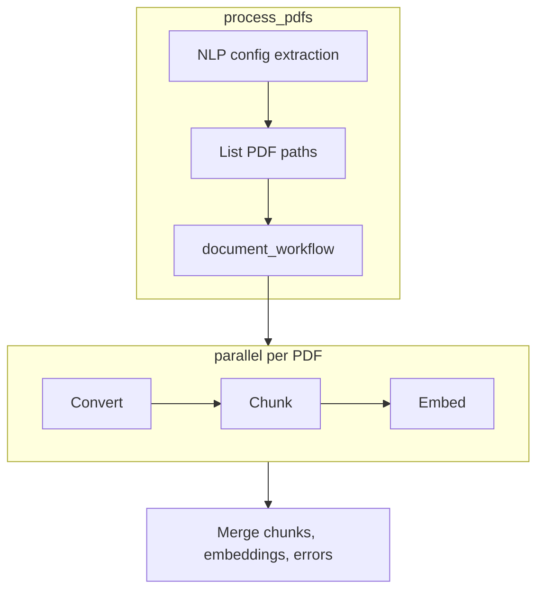

# PDF Processing Agent

LangGraph workflow that discovers PDFs, converts them in **parallel** with **docling**, chunks text with overlap, and requests **OpenAI-compatible** embeddings per chunk.

## Setup

1. **Python 3.11+** and [uv](https://docs.astral.sh/uv/) (recommended).

2. Install dependencies:

   ```bash
   uv sync
   ```

3. **Environment**: Create a `.env` file in the project root (see `.env` for the full list of configurable variables). All settings can also be overridden via shell environment variables.

## Usage

```python
from src.setup import load_environment_variables
from src.pdf_agent import process_pdfs

agent_settings = load_environment_variables(".env")
# or pass a config dict directly:
# agent_settings = {
#     "folder_path": "./pdfs",
#     "user_prompt": "Use VLM pipeline and hybrid chunking with 500 char chunks",  # optional NLP extraction
#     "embedding_model": "text-embedding-ada-002",
#     "embedding_dimensions": 1536,
#     "embedding_base_url": "https://api.openai.com/v1",
#     "embedding_api_key": "your-api-key-here",
#     "conversion_pipeline": "standard",  # or "vlm"
#     "chunking_strategy": "fixed",        # or "hybrid"
#     "chunk_size": 1000,
#     "chunk_overlap": 100,
#     "max_concurrency": 4,
# }

result = process_pdfs(agent_settings)
# result is a dict with keys:
#   documents      — list of chunk records (content + metadata)
#   embeddings     — list[list[float] | None], one per chunk
#   error_reports  — list of {"path", "error"} for files that failed
chunks = result["documents"]
vectors = result["embeddings"]
if result.get("error_reports"):
    for err in result["error_reports"]:
        print(f"Failed: {err['path']}: {err['error']}")
```

CLI (uses `FOLDER_PATH` and other variables from the `.env` file or the configured defaults):

```bash
uv run python -m src.pdf_agent
# Custom env file:
uv run python -m src.pdf_agent --envfile .env.local
# User prompt for NLP extraction:
uv run python -m src.pdf_agent --user_prompt "Use VLM pipeline and hybrid chunking"
```

## Environment Variables

| Variable | Default | Role |
|---|---|---|
| `FOLDER_PATH` | `./pdfs` | Directory containing PDF files to process |
| `EMBEDDING_API_KEY` | `your-api-key-here` | API key for the embedding endpoint |
| `EMBEDDING_BASE_URL` | `https://api.openai.com/v1` | Base URL of the OpenAI-compatible API |
| `EMBEDDING_MODEL` | `text-embedding-ada-002` | Model id passed to the embeddings API |
| `EMBEDDING_DIMENSIONS` | `1536` | Expected vector size for the chosen model |
| `CHUNK_SIZE` | `1000` | Characters per fixed-size chunk |
| `CHUNK_OVERLAP` | `100` | Overlap between consecutive fixed-size chunks |
| `CONVERSION_PIPELINE` | `standard` | `standard` (docling pipeline) or `vlm` (VLM pipeline) |
| `CHUNKING_STRATEGY` | `fixed` | `fixed` (character-based) or `hybrid` (document-aware) |
| `LLM_MODEL` | `gpt-4o-mini` | LLM model for NLP extraction |
| `BASE_URL` | `https://api.openai.com/v1` | Base URL for the LLM |
| `API_KEY` | `your-api-key-here` | API key for the LLM |
| `VLM_API_URL` | `https://api.openai.com/v1` | Remote VLM endpoint URL (required when `CONVERSION_PIPELINE=vlm`) |
| `VLM_API_HEADERS` | `{}` | JSON object of headers for the VLM API |
| `VLM_API_PARAMS` | `{}` | JSON object of params for the VLM API |
| `VLM_PRESET` | `smoldocling` | Preset name for the VLM conversion |
| `MAX_CONCURRENCY` | CPU count (`os.cpu_count()`) | Max parallel PDF pipelines |

## Architecture



## Workflow

1. **Extract config** (optional): If a `user_prompt` is provided (via CLI `--user_prompt` or the `user_prompt` config field), an LLM extracts configuration overrides. Unextractable parameters keep their `.env` defaults.
2. **Load PDFs**: Discover `*.pdf` files in `FOLDER_PATH`.
3. **Process in parallel**: For each PDF (up to `MAX_CONCURRENCY` at a time), run convert → chunk → embed. Conversion supports `standard` (default) or `vlm` pipelines; chunking supports `fixed` (character-based with `CHUNK_SIZE`/`CHUNK_OVERLAP`) or `hybrid` (docling `HybridChunker`).
4. **Aggregate results**: All chunks and embeddings are merged into `documents` and `embeddings`. Per-file failures are collected in `error_reports` without stopping other files.

## Module structure

- `src/pdf_agent.py` — entry point (`process_pdfs`, CLI)
- `src/graph/document_pipeline.py` — parallel per-document convert/chunk/embed pipeline
- `src/graph/chunking.py` — fixed-size and hybrid chunking
- `src/graph/embeddings.py` — OpenAI-compatible embedding client
- `src/graph/prompt_extraction.py` — NLP config extraction from natural language
- `src/setup/agent_settings.py` — `.env` loading

## Dependencies

Declared in `pyproject.toml`:

- `docling>=2.93.0`
- `langgraph>=1.2.0`
- `openai>=2.30.0`
- `python-dotenv>=1.2.2`

## License

GPL-3

## AI Disclosure

This project has been developed with the help of an AI Model. Specifically an instance of Qwen3.6-35B-A3B running in vLLM
